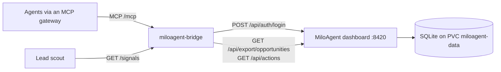
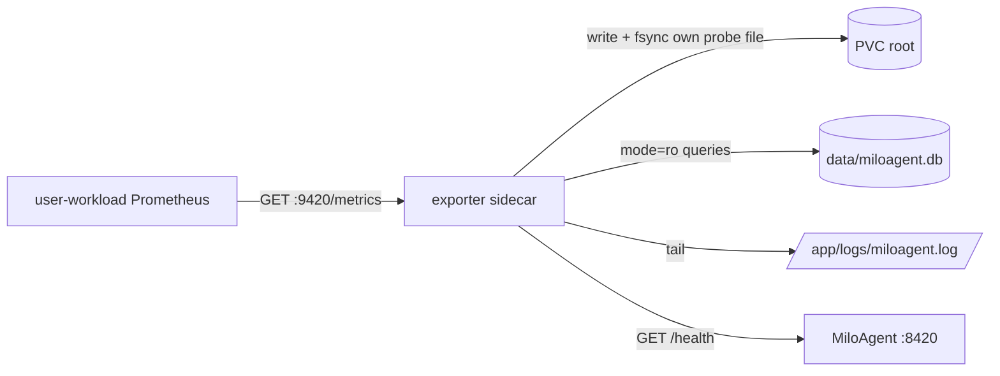

# miloagent-bridge

Read-only interface to MiloAgent. Agents read its findings and actions over MCP; a lead
scout reads them as signal records over HTTP. The bridge changes nothing in MiloAgent: no
tool approves, rejects, posts, pauses or configures. The same image holds a Prometheus
exporter that runs as a sidecar in the MiloAgent pod (see [Exporter](#exporter)).

- Streamable HTTP, stateless, on port 8000 at `/mcp`; `GET /healthz` answers `{"status": "ok"}`.
- `GET /signals` answers signal records (see [GET /signals](#get-signals)).
- Python 3.12, MCP Python SDK 2.x (`mcp.server.mcpserver.MCPServer`).
- Image: `ghcr.io/hoolia/miloagent-bridge:sha-<commit>`, non-root, runs as any UID in group 0.

## How it reads MiloAgent



- MiloAgent keeps its data in SQLite (`/app/data/miloagent.db`, WAL) on its RWO volume.
  The bridge never opens that file; it uses MiloAgent's own dashboard API.
- The dashboard issues an in-memory session token on login and forgets it on restart.
  The client logs in once, sends the token as bearer, and logs in again once on a 401.
- Besides the login the client sends two GET requests only. `MiloAgentClient` has no
  generic request method; `tests/test_client.py` holds that.
- Answers are cached for `MILOAGENT_CACHE_SECONDS` (default 60) per export.

## MCP tools

| Tool | MiloAgent API | Returns |
| --- | --- | --- |
| `list_findings(since?, limit=50, status?)` | `GET /api/export/opportunities?status=` per status | findings newest first |
| `get_finding(id)` | same, filtered by id | one finding with post text, draft reply, rejection reason |
| `list_actions(since?, limit=100)` | `GET /api/actions?limit=200` | MiloAgent's own comments and posts, newest first |

A finding is a row of MiloAgent's `opportunities` table: a Reddit post it judged relevant
to a project. Statuses are `pending`, `awaiting_approval`, `acted`, `skipped`, `failed`
and `rejected`. `list_actions` sees MiloAgent's newest 200 actions of the last year.
Tool descriptions mark Reddit text as untrusted data.

## GET /signals

`GET /signals?since=<ISO 8601>&limit=<1..5000>`; `since` defaults to seven days ago.
Answers `{"count", "signals": [...]}`, newest first, Reddit findings only.

| Field | Value |
| --- | --- |
| `id` | UUID v5 of `reddit|<url>|<actor_key>` |
| `source` | `reddit` |
| `url` | `https://www.reddit.com/r/<subreddit>/comments/<post id>/` |
| `actor_key`, `actor_person` | Reddit username of the post author when MiloAgent stored one, else `""` and `null` |
| `actor_company` | `null` |
| `signal_type` | `stated_need` |
| `excerpt` | title and post text, at most 1000 characters |
| `observed_at` | post time (`created_utc`) when stored, else the time MiloAgent found it |
| `rule_id` | `<MiloAgent project>/r/<subreddit>` |
| `author`, `title`, `text`, `created_at` | the same values under the names that scouts reading findings expect |
| `miloagent` | `{id, status, score}` of the finding |

`MILOAGENT_SIGNAL_STATUSES` chooses which finding statuses become signals; the default
leaves out `rejected`. Errors: 400 for a bad `since` or `limit`, 502 when MiloAgent fails.

MiloAgent's scanner currently stores no post author or post time (metadata holds
`keyword`, `post_score`, `num_comments`, `upvote_ratio`), so `actor_key` is empty and
`observed_at` is the discovery time until MiloAgent itself stores them.

## Exporter

The same image holds a Prometheus exporter, `python3 -m miloagent_bridge.exporter`
(`miloagent-exporter`). It runs as a sidecar in the MiloAgent pod, because MiloAgent's
volume is RWO and its log is an `emptyDir` of that pod. MiloAgent's `GET /health`
answers from memory, so a read-only or failing volume does not show there; the exporter
shows it.



- It collects every `EXPORTER_INTERVAL_SECONDS` (30) and serves the last result at
  `GET /metrics`; `GET /healthz` answers `{"status": "ok"}`. After a failed collection
  `/metrics` answers 503 until one succeeds, and also once the last result is older than
  three intervals plus three timeouts (a collection hung on a dead volume), so no stale
  values are scraped.
- The volume probe runs in a thread with a timeout: a hung `fsync` reports
  `miloagent_volume_probe_stuck 1` and does not block a scrape.
- Log counters start at zero when the exporter starts and count the whole current log
  file; after a rotation the rest of the old file is read, then the new file from its start, and a
  truncated file is read again from its start.
- Every SQLite error kind, and every result of each scheduled job the log names (`Added
  job ... to job store`), is exported from 0 on, so `increase()` sees the first error.

| Metric | Type | Meaning |
| --- | --- | --- |
| `miloagent_up` | gauge | 1 when `GET /health` answers 200 |
| `miloagent_volume_writable` | gauge | 1 when the probe file at the volume root was written and fsynced |
| `miloagent_volume_readonly` | gauge | 1 when `statvfs` reports the file system read-only |
| `miloagent_volume_probe_stuck`, `miloagent_volume_probe_duration_seconds` | gauge | probe that has not returned; duration of the last probe |
| `miloagent_db_readable`, `miloagent_db_size_bytes` | gauge | read-only query answered; size of the main file |
| `miloagent_account_health_timestamp_seconds{platform,account,status}` | gauge | last `account_health` row; the hourly `health_check` job writes it |
| `miloagent_last_action_timestamp_seconds{platform,result}` | gauge | last stored action, `success` or `failure` |
| `miloagent_opportunities{status}`, `miloagent_last_opportunity_timestamp_seconds{status}` | gauge | stored findings per status and the newest one |
| `miloagent_scheduler_job_runs_total{task,result}` | counter | APScheduler job runs (`task` is the job function; Prometheus keeps `job` for the scrape job): `success`, `error` (raised an exception), `missed` |
| `miloagent_scheduler_job_last_timestamp_seconds{task,result}` | gauge | last run per task and result |
| `miloagent_log_db_errors_total{kind}` | counter | log lines with SQLite errors: `db_io`, `db_readonly`, `db_malformed`, `db_full`, `db_locked` |
| `miloagent_log_messages_total{level}` | counter | `WARNING`, `ERROR`, `CRITICAL` lines |
| `miloagent_last_scan_complete_timestamp_seconds` | gauge | last `Scan cycle complete`, else the exporter start |
| `miloagent_reddit_blocked_subreddits` | gauge | subreddits inside Reddit's skip time (403 or 429 blocks) |
| `miloagent_reddit_subreddit_blocked_until_seconds{subreddit,status}` | gauge | end of each skip time |
| `miloagent_reddit_token_expired_timestamp_seconds{account}` | gauge | last `token_v2 expired` per Reddit account |
| `miloagent_exporter_start_time_seconds`, `miloagent_exporter_log_readable`, `miloagent_exporter_log_lines_total` | | exporter state |

| Variable | Default | Meaning |
| --- | --- | --- |
| `EXPORTER_VOLUME_DIR` | `/volume` | Mount of the PVC root; the probe file `.miloagent-exporter-probe` goes here |
| `EXPORTER_DB_PATH` | `/volume/data/miloagent.db` | MiloAgent's database |
| `EXPORTER_LOG_PATH` | `/app/logs/miloagent.log` | MiloAgent's log file |
| `EXPORTER_HEALTH_URL` | `http://127.0.0.1:8420/health` | MiloAgent's health endpoint |
| `EXPORTER_PORT` | `9420` | Listen port |
| `EXPORTER_INTERVAL_SECONDS`, `EXPORTER_TIMEOUT_SECONDS` | `30`, `10` | Collection interval; timeout of the probe and the health call |

The sidecar runs as the pod's user (MiloAgent runs as root and owns the volume), with
every capability dropped, and mounts the log volume read-only.

## Configuration

| Variable | Required | Meaning |
| --- | --- | --- |
| `MILOAGENT_URL` | yes | Base URL of the dashboard, for example `http://miloagent:8420` |
| `MILOAGENT_PASSWORD` | yes | Dashboard password (`MILO_WEB_PASS` of MiloAgent) |
| `MILOAGENT_USERNAME` | no | Dashboard user, default `admin` |
| `MILOAGENT_SIGNAL_STATUSES` | no | Comma-separated statuses for `/signals` |
| `MILOAGENT_TIMEOUT` | no | Seconds per request, default `30` |
| `MILOAGENT_CACHE_SECONDS` | no | Cache lifetime, default `60` |

MiloAgent's login limit is 10 attempts per minute per client address; the bridge logs in
once per MiloAgent restart or 24 hours.

## Deploy

Run the bridge in the namespace of MiloAgent, so it reads the dashboard password from
MiloAgent's own Secret. Any chart that runs one container with environment variables
from a Secret fits. Values of a generic MCP server chart, for example:

```yaml
image:
  repository: ghcr.io/hoolia/miloagent-bridge
  tag: sha-<commit>
env:
  MILOAGENT_URL: http://miloagent:8420
secretEnv:
- name: MILOAGENT_PASSWORD
  secret: <Secret holding MILO_WEB_PASS>
  key: MILO_WEB_PASS
port: 8000
path: /mcp
mcp:
  targetName: miloagent
networkPolicy:
  # the namespaces of the MCP gateway and the scout
  ingressNamespaces:
  - matchLabels:
      kubernetes.io/metadata.name: <gateway namespace>
  egress:
    allow:
    - cidr: <pod network CIDR>   # the MiloAgent pod
      ports: [8420]
```

The exporter runs from the same image as an `extraContainers` entry of the MiloAgent
chart (`deploy/values.yaml`), with `command: [python3, -m, miloagent_bridge.exporter]`,
a port named `metrics` (9420), the volume `data` at `/volume` and the volume `logs` at
`/app/logs` read-only. [docs/alerts.md](../docs/alerts.md) is the runbook of its alerts.

## Develop

From this directory:

```sh
uv venv -p 3.12 .venv
uv pip install -p .venv/bin/python --require-hashes -r requirements.lock
uv pip install -p .venv/bin/python --no-deps -e .
uv pip install -p .venv/bin/python pytest==9.2.0 pytest-asyncio==1.5.0 respx==0.23.1
.venv/bin/python -m pytest -q
```

`requirements.lock` is generated from `pyproject.toml`:

```sh
uv pip compile pyproject.toml --python-version 3.12 --python-platform x86_64-manylinux_2_28 --generate-hashes -o requirements.lock
```

## Build

The workflow `.github/workflows/build-bridge-image.yml` builds `bridge/Containerfile`
with `bridge/` as context and pushes `ghcr.io/<repository owner>/miloagent-bridge` on
every change to `bridge/` in `main` (tags `latest` and `sha-<commit>`). The workflow
`bridge-test.yml` runs the tests on every pull request that changes `bridge/`.

```sh
podman build -t miloagent-bridge:dev -f Containerfile .
```
