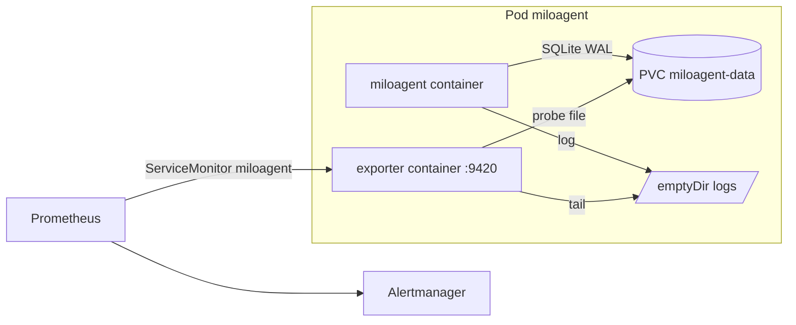

# Alerts of MiloAgent

Runbook for every alert of the Helm chart in `deploy/` (`templates/prometheusrule.yaml`).
The chart renders the rules, a ServiceMonitor and the Service `<release>-metrics` with
`monitoring.enabled: true`. This page covers the alerts only; it does not cover alert
routing, which belongs to the cluster's Alertmanager.



- The `miloagent_*` series come from an exporter container in the pod with a port named
  `metrics`, added with the chart value `extraContainers`. It reads the log and the
  database read-only and writes only its own probe file at the root of the data volume.
- `MiloAgentNotReady`, `MiloAgentRestarting` and `MiloAgentVolumeFillingUp` read
  kube-state-metrics and the kubelet. Every other alert reads the exporter and stays
  silent while `MiloAgentMetricsDown` fires.
- Chart values: `monitoring.rules.labels` adds labels to every alert (Alertmanager
  routing), `monitoring.rules.runbookBaseUrl` points the `runbook_url` annotations at
  another copy of this page, and `monitoring.rules.noRecentScan` sets the hours of
  `MiloAgentNoRecentScan`.
- A container restart keeps the volume mount, so a read-only volume shows as
  `MiloAgentRestarting` until the pod is recreated.

Legend: **safe** reads only; **write** changes the running pod or its volume.

The commands assume release `miloagent`, so Deployment `miloagent` and PVC
`miloagent-data`. Set the namespace first:

```bash
ns=<namespace of the release>
```

## Exporter metrics

| Series | Meaning |
|---|---|
| `miloagent_volume_writable` | 1 when the probe file on the data volume was written and fsynced |
| `miloagent_volume_readonly` | 1 when `statvfs` reports the data volume read-only |
| `miloagent_log_db_errors_total{kind}` | SQLite errors in the log: `db_io`, `db_readonly`, `db_malformed`, `db_full`, `db_locked` |
| `miloagent_scheduler_job_runs_total{task,result}` | scheduled job runs, `result` `success` or `error` |
| `miloagent_last_scan_complete_timestamp_seconds` | time of the last `Scan cycle complete` log line, or the exporter start |
| `miloagent_account_health_timestamp_seconds{platform,account,status}` | time of the newest `account_health` row per account |
| `miloagent_reddit_token_expired_timestamp_seconds{account}` | time of the last `token_v2 expired` log line per account |
| `miloagent_reddit_blocked_subreddits` | subreddits Reddit currently answers 403 or 429 for |

## Read the exporter and the log

Most checks below start here.

1. **safe** Read the exporter's current values:

    ```bash
    oc -n $ns exec deploy/miloagent -c exporter -- python3 -c \
      'import urllib.request;print(urllib.request.urlopen("http://127.0.0.1:9420/metrics").read().decode())' \
      | grep -v '^#'
    ```

2. **safe** Read MiloAgent's log; it lives in the pod and is lost when the pod is
   recreated:

    ```bash
    oc -n $ns exec deploy/miloagent -c miloagent -- tail -200 /app/logs/miloagent.log
    ```

### MiloAgentDataVolumeNotWritable

The exporter could not write and fsync its probe file at the root of PVC
`miloagent-data`, or `statvfs` reports the file system read-only, for 5 minutes. Every
SQLite write of MiloAgent fails; `GET /health` and the readiness probe still pass. An ext4
volume that goes `emergency_ro` after file system errors shows this way.

Check:

1. **safe** `oc -n $ns exec deploy/miloagent -c miloagent -- sh -c 'mount | grep /app/data; touch /app/data/.write-test && echo writable'`
   prints `ro` and `Read-only file system` when the volume went read-only.
2. **safe** `oc -n $ns logs deploy/miloagent -c exporter --tail=20` names the probe
   error (`Read-only file system`, `Input/output error`, `probe did not finish`).

Fix:

1. **write** Take a VolumeSnapshot before anything touches the volume:

    ```bash
    t=$(date -u +%Y%m%dt%H%Mz)
    oc -n $ns apply -f - <<EOF
    apiVersion: snapshot.storage.k8s.io/v1
    kind: VolumeSnapshot
    metadata:
      name: miloagent-data-pre-fsck-$t
    spec:
      volumeSnapshotClassName: <snapshot class of the storage class>
      source:
        persistentVolumeClaimName: miloagent-data
    EOF
    oc -n $ns get volumesnapshot miloagent-data-pre-fsck-$t -w   # wait for READYTOUSE true
    ```

2. **write** Recreate the pod. The Deployment uses `Recreate`, so the volume is unmounted,
   checked and mounted again read-write on start:

    ```bash
    oc -n $ns rollout restart deploy/miloagent
    oc -n $ns rollout status deploy/miloagent
    ```

3. **safe** Verify: the mount shows `rw`, and SQLite answers `ok`:

    ```bash
    oc -n $ns exec deploy/miloagent -c miloagent -- sh -c 'mount | grep /app/data'
    oc -n $ns exec deploy/miloagent -c miloagent -- python3 -c \
      'import sqlite3;print(sqlite3.connect("file:/app/data/miloagent.db?mode=ro",uri=True).execute("PRAGMA integrity_check").fetchone()[0])'
    ```

Rollback: none needed for the restart. When `integrity_check` does not answer `ok`,
restore the snapshot into a new PVC and point the chart at it; that branch has not run yet
(draft). What MiloAgent held only in memory while the volume was read-only is lost.

### MiloAgentDatabaseWriteErrors

MiloAgent logged `disk I/O error`, `attempt to write a readonly database`,
`database disk image is malformed` or `database or disk is full` in the last 30 minutes.
`database is locked` does not count.

Check:

1. **safe** `oc -n $ns exec deploy/miloagent -c miloagent -- grep -n -E 'disk I/O|readonly database|malformed|disk is full' /app/logs/miloagent.log | tail`
2. With `MiloAgentDataVolumeNotWritable` firing as well, follow that section.
3. `malformed` alone: run the `integrity_check` of the section above.
4. `disk is full`: see `MiloAgentVolumeFillingUp`.

### MiloAgentScheduledJobFailing

An APScheduler job (`task` label, for example `_health_check`, `_scan_all_safe`,
`_db_maintenance`) raised an exception in the last 2 hours.

Check:

1. **safe** Find the traceback; it follows the line `raised an exception`:

    ```bash
    oc -n $ns exec deploy/miloagent -c miloagent -- grep -n -A25 'raised an exception' /app/logs/miloagent.log | tail -60
    ```

2. A `sqlite3.OperationalError` in the traceback: see `MiloAgentDatabaseWriteErrors`.
   Another error is a MiloAgent defect: open an issue at github.com/hoolia/miloagent with
   the traceback.

### MiloAgentNoRecentScan

No `Scan cycle complete` in the log for more than `noRecentScan.maxAgeHours` (3) hours,
between `noRecentScan.fromHour` and `noRecentScan.toHour` UTC (11 and 23). MiloAgent scans
only inside `bot.active_hours` of its settings; set `fromHour` to the first active hour
plus `maxAgeHours`. After a pod start the exporter counts from its own start, so a new pod
does not alert.

Check:

1. **safe** `oc -n $ns exec deploy/miloagent -c miloagent -- grep -n -E 'Starting scan cycle|Scan cycle complete|_scan_all_safe' /app/logs/miloagent.log | tail`
2. `Starting scan cycle` without `Scan cycle complete`: the scan hangs or raised; see the
   traceback after `_scan_all_safe`.
3. No `Starting scan cycle` at all: the bot is paused in the dashboard (button
   Pause/Resume) or the scheduler stopped; `oc -n $ns rollout restart deploy/miloagent`
   (**write**) starts it again.

### MiloAgentAccountHealthStale

The hourly `_health_check` job has not written an `account_health` row for more than 3
hours. It skips the run while the bot is paused or the resource check fails, and it fails
when the database takes no writes.

Check:

1. **safe** `MiloAgentDataVolumeNotWritable`, `MiloAgentDatabaseWriteErrors` or
   `MiloAgentScheduledJobFailing` firing: fix that first.
2. **safe** `oc -n $ns exec deploy/miloagent -c miloagent -- grep -n -E 'health check|_health_check|paused' /app/logs/miloagent.log | tail`

### MiloAgentNotReady

Deployment `miloagent` has had no available replica for 15 minutes; the dashboard answers
errors and no scan runs.

Check:

1. **safe** `oc -n $ns get pods -l app=miloagent -o wide` and `oc -n $ns describe pod -l app=miloagent | tail -30`
2. `Multi-Attach error` or `FailedMount`: the ReadWriteOnce volume is still attached to
   another node; read the attachment with `oc get volumeattachment | grep <pv name>` and
   ask the storage owner before touching it.
3. `ImagePullBackOff`: the MiloAgent image (`image.repository`) or the exporter image is
   not reachable.

### MiloAgentRestarting

A container of the MiloAgent pod restarted more than twice in an hour.

Check:

1. **safe** `oc -n $ns describe pod -l app=miloagent | grep -E -A3 'Last State|Liveness|Unhealthy'`
2. `Liveness probe failed` on container `miloagent` with `Read-only file system`,
   `Input/output error` or `readonly database`: the volume, see
   `MiloAgentDataVolumeNotWritable`. A container restart does not remount it.
3. `OOMKilled`: raise `resources.limits.memory` in the chart values.
4. Container `exporter`: `oc -n $ns logs deploy/miloagent -c exporter --previous`.

### MiloAgentVolumeFillingUp

PVC `miloagent-data` has been more than 85 % full for 30 minutes.

Check:

1. **safe** `oc -n $ns get pvc miloagent-data` and `oc -n $ns get events --field-selector involvedObject.name=miloagent-data`
2. `exceeded quota`: the namespace storage quota is full; raise it or free space.
3. **safe** `oc -n $ns exec deploy/miloagent -c miloagent -- du -sh /app/data/* /app/projects`
   shows what grew; `database.max_size_mb` and `database.retention_days` in the settings
   limit the database.
4. **write** Grow the volume: raise `persistence.size`, when the storage class allows
   expansion.

### MiloAgentMetricsDown

Prometheus has no `up` sample of `job="miloagent-metrics"`, or the target is down, for 15
minutes.

Check:

1. **safe** `oc -n $ns get pods -l app=miloagent -o jsonpath='{.items[0].spec.containers[*].name}'`
   lists `miloagent exporter`; without `exporter` the chart values lost
   `extraContainers`.
2. **safe** `oc -n $ns get endpoints miloagent-metrics` lists the pod on port 9420.
3. **safe** `oc -n $ns logs deploy/miloagent -c exporter --tail=20`

### MiloAgentRedditTokenExpired

MiloAgent logged `token_v2 expired for u/<account>` in the last 24 hours. It cannot post
or comment as that account; approved drafts fail.

Fix: **manual** sign in to reddit.com as the account, copy its cookies, and paste them in
the MiloAgent dashboard (tab Config, Cookie Sessions, Paste Cookies). The accounts live in
`data/accounts_added.yaml` on the volume. The alert resolves 24 hours after the last
expired-token line, or at a pod restart.

### MiloAgentRedditBlocked

Reddit has answered 403 or 429 for at least 5 subreddits for 12 hours (severity `info`).
MiloAgent skips a blocked subreddit for 4 hours and tries again; scans of those
subreddits find nothing.

Check:

1. **safe** `oc -n $ns exec deploy/miloagent -c miloagent -- grep -c 'Reddit blocked r/' /app/logs/miloagent.log`
   and the exporter's `miloagent_reddit_subreddit_blocked_until_seconds` per subreddit.

Reddit decides the block; MiloAgent has no setting that lifts it. Silence the alert when
the block is accepted.
