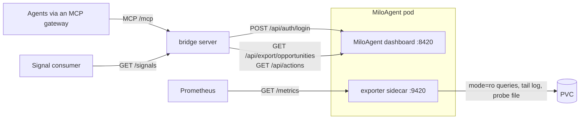

# MiloAgent bridge

The bridge is a read-only interface to MiloAgent. Agents read its findings and actions
over MCP, other services read them as signal records over HTTP, and Prometheus reads
its health from an exporter. The bridge changes nothing in MiloAgent: no tool approves,
rejects, posts, pauses or configures.

- Source: `bridge/` (Python 3.12, MCP Python SDK 2.x), tests in `bridge/tests/`.
- Image: `ghcr.io/hoolia/miloagent-bridge`, built by `.github/workflows/bridge.yml`
  with the tags of the MiloAgent image: `sha-<commit>`, `latest` on `main`, the git
  tag on `v*`. It runs as any non-root UID in group 0.
- Chart: on by default (`bridge.enabled`); `deploy/values.yaml` documents every value.



## Chart components

| Component | Values | Objects | Rendered |
| --- | --- | --- | --- |
| Server | `bridge.server` | Deployment, Service and NetworkPolicy `<release>-bridge`, port 8000 | `bridge.enabled` and `bridge.server.enabled` |
| Exporter | `bridge.exporter` | container `exporter` in the MiloAgent pod, port `monitoring.port` | also `monitoring.enabled` |

- With `bridge.enabled: false` the chart renders exactly what it renders without the
  bridge; `tests/chart/run.sh` holds that.
- The server logs in as `env.MILO_WEB_USER` with the password from
  `bridge.server.passwordSecret`, else `MILO_WEB_PASS` of the chart's env Secret, else of
  `existingSecrets.env`.
- The server answers without authentication. Its NetworkPolicy admits the own
  namespace and `bridge.server.networkPolicy.ingressNamespaces` only; put an MCP
  gateway in front for agents. `bridge.server.mcp.targetName` adds the annotations
  `agentgateway.dev/mcp-path` and `agentgateway.dev/mcp-target-name` for an agentgateway.
- `bridge.server.networkPolicy.egress.enabled` limits the server's egress to DNS and
  MiloAgent's dashboard port.
- The chart refuses an `extraContainers` entry named `exporter` while it adds its own:
  move a hand-made exporter to `bridge.exporter`.

## Server

- Streamable HTTP, stateless, on port 8000 at `/mcp`; `GET /healthz` answers
  `{"status": "ok"}`.
- MiloAgent keeps its data in SQLite on its RWO volume. The server never opens that
  file; it uses MiloAgent's own dashboard API.
- The dashboard issues an in-memory session token on login and forgets it on restart.
  The client logs in once, sends the token as bearer, and logs in again once on a 401.
- Besides the login the client sends two GET requests only. `MiloAgentClient` has no
  generic request method; `bridge/tests/test_client.py` holds that.
- Answers are cached for `MILOAGENT_CACHE_SECONDS` (default 60) per export.

### MCP tools

| Tool | MiloAgent API | Returns |
| --- | --- | --- |
| `list_findings(since?, limit=50, status?)` | `GET /api/export/opportunities?status=` per status | findings newest first |
| `get_finding(id)` | same, filtered by id | one finding with post text, draft reply, rejection reason |
| `list_actions(since?, limit=100)` | `GET /api/actions?limit=200` | MiloAgent's own comments and posts, newest first |

A finding is a row of MiloAgent's `opportunities` table: a Reddit post it judged relevant
to a project. Statuses are `pending`, `awaiting_approval`, `acted`, `skipped`, `failed`
and `rejected`. `list_actions` sees MiloAgent's newest 200 actions of the last year.
Tool descriptions mark Reddit text as untrusted data.

### GET /signals

`GET /signals?since=<ISO 8601>&limit=<1..5000>`; `since` defaults to seven days ago.
Answers `{"count", "signals": [...]}`, newest first, Reddit findings only.

| Field | Value |
| --- | --- |
| `id` | UUID v5 of `reddit|<url>|<actor_key>` |
| `source` | `reddit` |
| `url` | `https://www.reddit.com/r/<subreddit>/comments/<post id>/` |
| `actor_key`, `actor_person` | Reddit username of the post author when MiloAgent stored one, else `""` and `null` |
| `actor_company` | `null` |
| `signal_type` | `stated_need` |
| `excerpt` | title and post text, at most 1000 characters |
| `observed_at` | post time (`created_utc`) when stored, else the time MiloAgent found it |
| `rule_id` | `<MiloAgent project>/r/<subreddit>` |
| `author`, `title`, `text`, `created_at` | the same values under common findings names |
| `miloagent` | `{id, status, score}` of the finding |

`MILOAGENT_SIGNAL_STATUSES` chooses which finding statuses become signals; the default
leaves out `rejected`. Errors: 400 for a bad `since` or `limit`, 502 when MiloAgent fails.

### Server configuration

| Variable | Required | Meaning |
| --- | --- | --- |
| `MILOAGENT_URL` | yes | Base URL of the dashboard; the chart sets `http://<release>:<service.port>` |
| `MILOAGENT_PASSWORD` | yes | Dashboard password |
| `MILOAGENT_USERNAME` | no | Dashboard user, default `admin` |
| `MILOAGENT_SIGNAL_STATUSES` | no | Comma-separated statuses for `/signals` |
| `MILOAGENT_TIMEOUT` | no | Seconds per request, default `30` |
| `MILOAGENT_CACHE_SECONDS` | no | Cache lifetime, default `60` |

MiloAgent's login limit is 10 attempts per minute per client address; the bridge logs in
once per MiloAgent restart or 24 hours.

## Exporter

The image also holds the Prometheus exporter, `python3 -m miloagent_bridge.exporter`. It
runs as a sidecar in the MiloAgent pod, because MiloAgent's volume is RWO and its log is
an `emptyDir` of that pod. MiloAgent's `GET /health` answers from memory, so a read-only
or failing volume does not show there; the exporter shows it.
[alerts.md](alerts.md) lists its series and is the runbook of every alert.

- It collects every `EXPORTER_INTERVAL_SECONDS` (30) and serves the last result at
  `GET /metrics`; `GET /healthz` answers `{"status": "ok"}`. After a failed collection,
  and once the last result is older than three intervals plus three timeouts, `/metrics`
  answers 503, so no stale values are scraped.
- The volume probe runs in a thread with a timeout: a hung `fsync` reports
  `miloagent_volume_probe_stuck 1` and does not block a scrape.
- It runs as root because MiloAgent's volume belongs to root, with every capability
  dropped, and mounts the log volume read-only.

| Variable | Default | Meaning |
| --- | --- | --- |
| `EXPORTER_VOLUME_DIR` | `/volume` | Mount of the PVC root; the probe file `.miloagent-exporter-probe` goes here |
| `EXPORTER_DB_PATH` | `/volume/data/miloagent.db` | MiloAgent's database |
| `EXPORTER_LOG_PATH` | `/app/logs/miloagent.log` | MiloAgent's log file |
| `EXPORTER_HEALTH_URL` | `http://127.0.0.1:8420/health` | MiloAgent's health endpoint; the chart sets it from `service.port` |
| `EXPORTER_PORT` | `9420` | Listen port; the chart sets `monitoring.port` |
| `EXPORTER_INTERVAL_SECONDS`, `EXPORTER_TIMEOUT_SECONDS` | `30`, `10` | Collection interval; timeout of the probe and the health call |

## Develop

The workflow `bridge` runs the tests and builds the image on every pull request that
changes `bridge/`. To run the tests elsewhere, from `bridge/`:

```sh
python3.12 -m venv .venv
.venv/bin/pip install --require-hashes -r requirements.lock
.venv/bin/pip install --no-deps -e .
.venv/bin/pip install pytest==9.2.0 pytest-asyncio==1.5.0 respx==0.23.1
.venv/bin/python -m pytest -q
```

`requirements.lock` is generated from `pyproject.toml`:

```sh
uv pip compile pyproject.toml --python-version 3.12 --python-platform x86_64-manylinux_2_28 --generate-hashes -o requirements.lock
```
